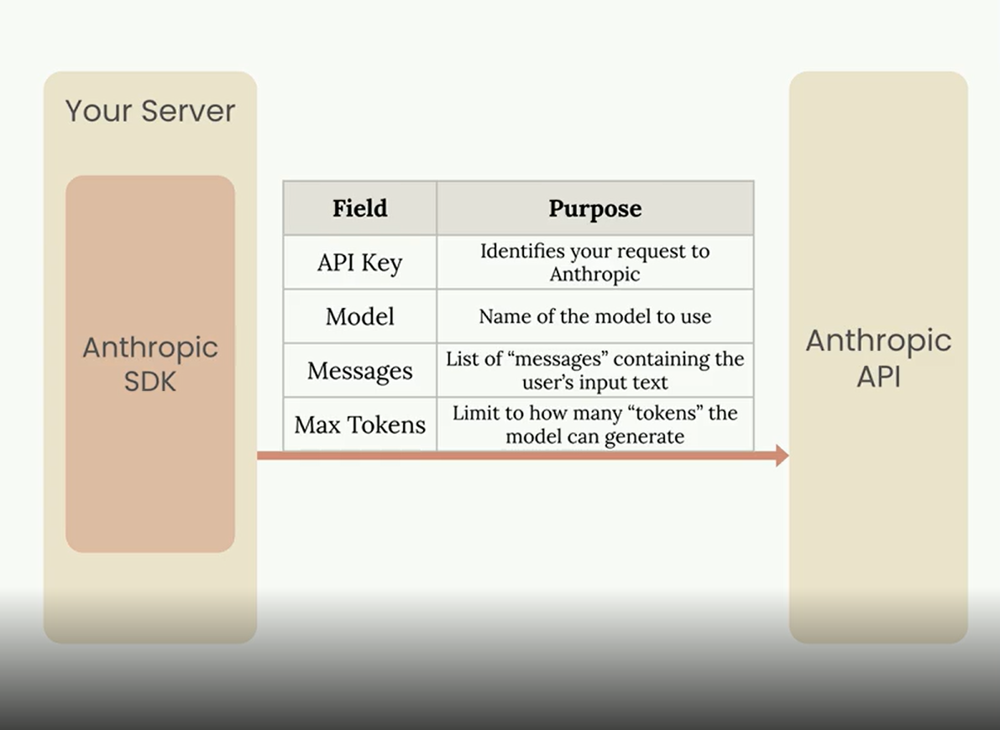
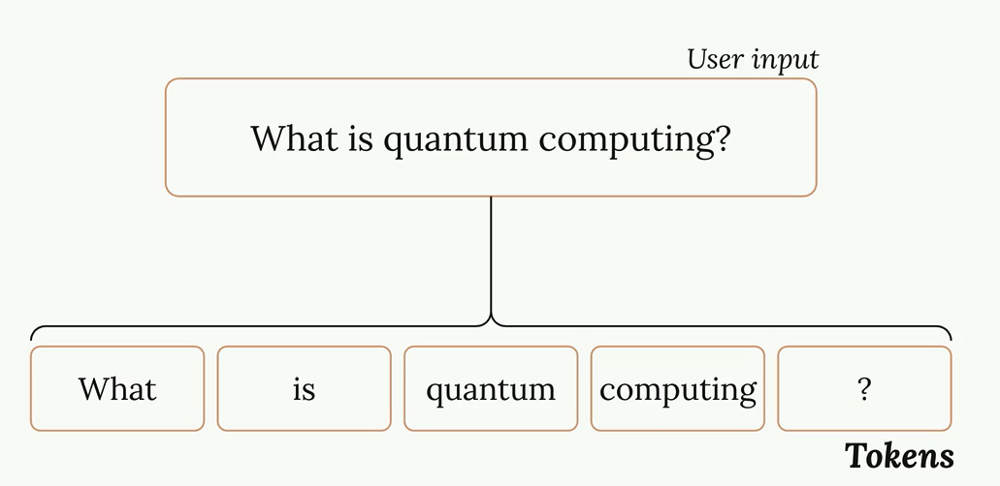

## **Familia de modelos Claude**

1. **Opus**
 - Resumen: Mayor nivel de inteligencia
 - Coste: Alto
 - Latencia: Moderada
 - Soporta Razonamiento: Si
 - Uso: Desarrollo avanzado de software, tareas complejas...

2. **Sonnet**
 - Resumen: Modelo inteligente y balanceado coste/inteligencia
 - Coste: Medio
 - Latencia: Rápido
 - Soporta Razonamiento: Si
 - Uso: Desarrollo básico de software, tareas de documentación...
 
3. **Haiku**
 - Resumen: Modelo económico y rápido
 - Coste: Bajo
 - Latencia: Muy rápida
 - Soporta Razonamiento: No
 - Uso: Completados rápidos de código, categorización, traducción...

---

## **¿Qué se necesita para procesar una petitición?**

 - API Key
 - Modelo
 - Mensajes del usuario
 - Tokens máximos

 

## **¿Qué es un token?**

Un token es cada una de las string que le pasamos al modelo.   

Cada String se convertirá al embeding, que es una larga lista de números que representarán la string.

 